  

## Hey, I'm Skipper 👋

**Building things for fun.**

I'm a student at **Semiahmoo Secondary School** in **South Surrey, BC, Canada**. I'm interested in mechatronics: how mechanics, electronics, and code come together to make things move.

Right now, I'm exploring robotics through browser simulations and programming projects. This is where I share what I'm making and learning along the way.

`he/him` · `mechatronics` · `robotics` · `programming`

---

### Featured project · Robot Playground

Program a 3D robot in the browser, solve pick-and-place challenges, and share your own layouts and programs by link.

[**Open Robot Playground →**](https://niceskipperchen-coder.github.io/robot-playground/) · [Code and documentation](https://github.com/niceskipperchen-coder/robot-playground)

- CodeMirror editor with autocomplete, execution highlighting, and line-specific errors.
- Run, pause, resume, and step through a bounded robot command language.
- Three built-in challenges, a custom challenge builder, and shareable links.
- Tested parser, simulator, sharing, and challenge completion, with 30 automated tests.

Built with JavaScript, CodeMirror, and Three.js. This extends my simulator into a programming environment for exploring interpreters, execution state, and robot control.

### Featured project · 3D robotic arm simulator

A browser-based SCARA-style robot with three positioning axes, an opening gripper, and interactive pick-and-place.

[**Try the simulator →**](https://niceskipperchen-coder.github.io/robotic-arm-simulator/) · [View the code and documentation](https://github.com/niceskipperchen-coder/robotic-arm-simulator)

- Rotate the 3D view, control joint angles, or set Cartesian targets.
- Lower the tool, grasp a block, lift it, and place it on the pad.
- Explore forward/inverse kinematics, reach limits, and position error.
- Includes 17 automated tests and documentation of the model's assumptions.

Built with JavaScript and Three.js. I'm using this project as a starting point for studying robot kinematics and documenting my own experiments and improvements.

