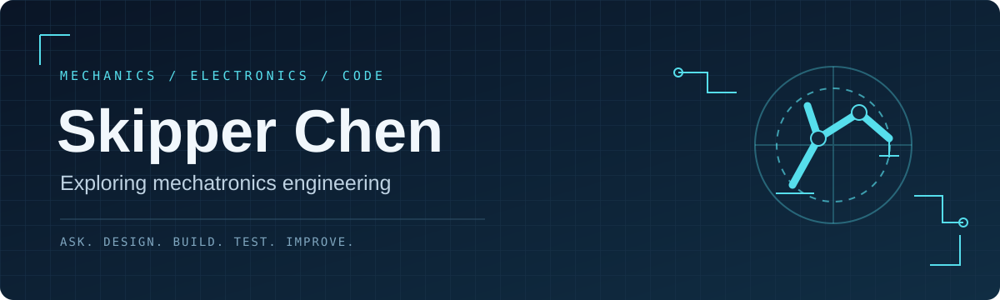

  

  <b>MECHANICAL SYSTEMS &nbsp; / &nbsp; ELECTRONICS & CONTROL &nbsp; / &nbsp; COMPUTING</b>

## Hi, I'm Skipper

I'm an aspiring mechatronics engineering student interested in how mechanical systems, electronics, and software come together to make machines work.

I want to understand both the physical mechanism and the code behind it: how a machine moves, how it senses its surroundings, and how it decides what to do next.

### What interests me

| Mechanics | Electronics & control | Computing |
| :--- | :--- | :--- |
| Mechanisms, motion, and mechanical design | Sensors, circuits, and feedback | Programming, automation, and intelligent systems |
| How do we turn an idea into a working mechanism? | How can a machine sense and respond? | How can code connect decisions to physical actions? |

### My engineering approach

**Ask → Design → Build → Test → Improve**

My goal is to use this space to document the whole process: the question behind a project, design choices, experiments, what fails, and what changes as a result.

### Featured project · Robot Playground

Program a 3D robot in the browser, solve pick-and-place challenges, and share your own layouts and programs by link.

[**Open Robot Playground →**](https://niceskipperchen-coder.github.io/robot-playground/) · [Code and documentation](https://github.com/niceskipperchen-coder/robot-playground)

- CodeMirror editor with autocomplete, execution highlighting, and line-specific errors.
- Run, pause, resume, and step through a bounded robot command language.
- Three built-in challenges, a custom challenge builder, and shareable links.
- Tested parser, simulator, sharing, and challenge completion, with 30 automated tests.

Built with JavaScript, CodeMirror, and Three.js, with Codex assistance. This extends my simulator into a programming environment for exploring interpreters, execution state, and robot control.

### Featured project · 3D robotic arm simulator

A browser-based SCARA-style robot with three positioning axes, an opening gripper, and interactive pick-and-place.

[**Try the simulator →**](https://niceskipperchen-coder.github.io/robotic-arm-simulator/) · [View the code and documentation](https://github.com/niceskipperchen-coder/robotic-arm-simulator)

- Rotate the 3D view, control joint angles, or set Cartesian targets.
- Lower the tool, grasp a block, lift it, and place it on the pad.
- Explore forward/inverse kinematics, reach limits, and position error.
- Includes 17 automated tests and documentation of the model's assumptions.

Built with JavaScript and Three.js, with Codex assistance. I'm using this project as a starting point for studying robot kinematics and documenting my own experiments and improvements.

---

Curious about how things move. Interested in what makes them think.

